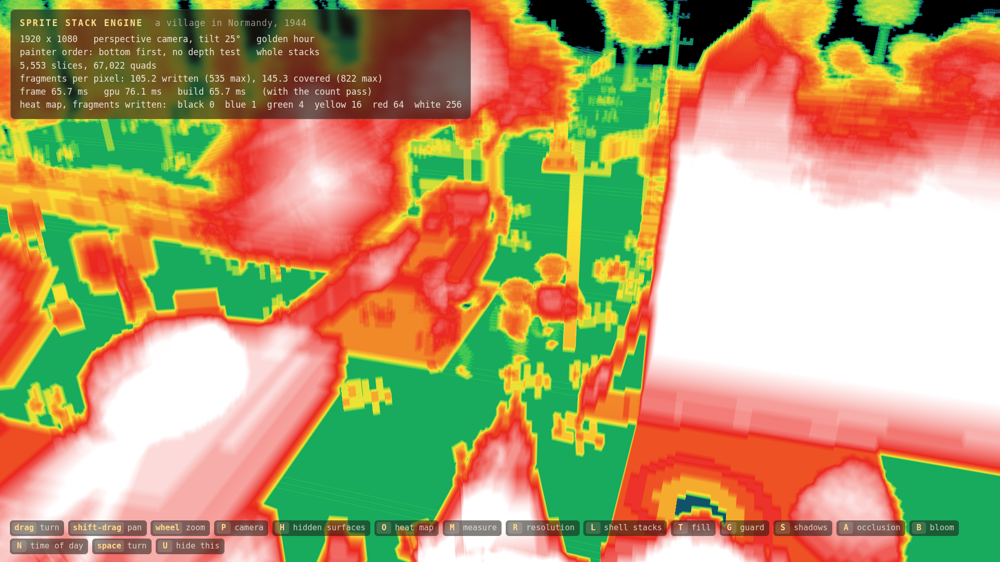
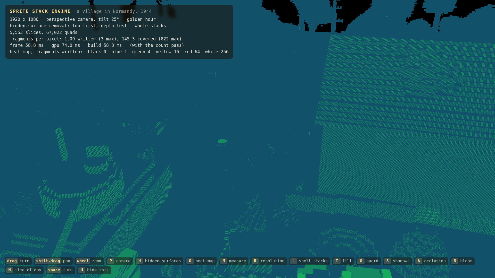
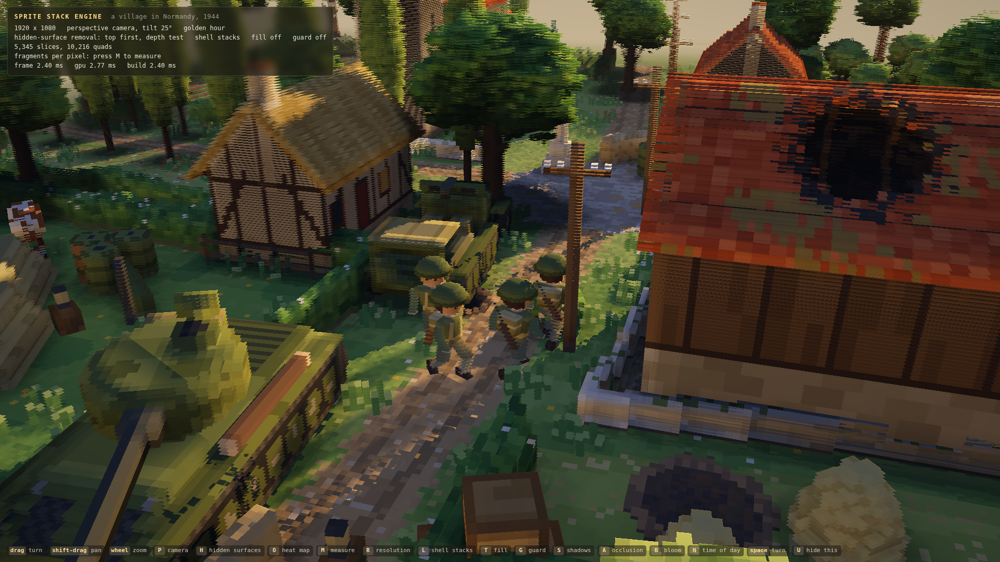
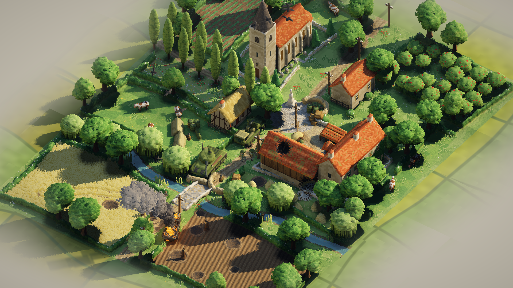
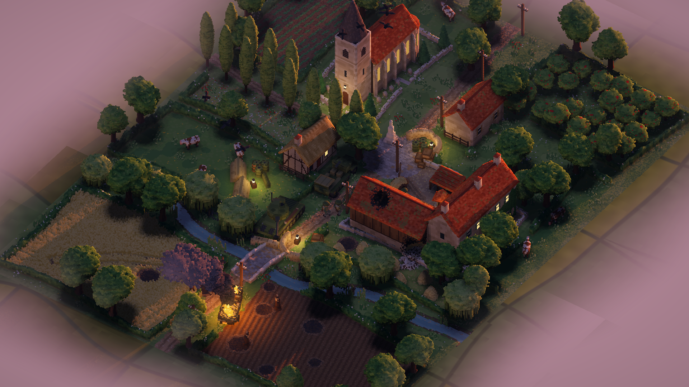

# Sprite stack engine


A small sprite-stacking renderer in plain WebGL2, with no libraries. Everything on screen is a stack of flat
slices, drawn as textured quads. The camera turns, tilts and zooms freely, in a parallel or a perspective
view, and the cost stays near one fragment written per pixel.

Designed and directed by @loktar00; the code was written by Claude (AI) under his direction.

**[Live demo](https://loktar00.github.io/sprite-stack-engine/)**

It exists to test two claims about sprite stacking with numbers instead of opinions:

- *"Slices break apart with a free camera."* They do if you draw one quad per slice. They do not if every
  slice is drawn once per screen row its layer covers. Press **T** to see both.
- *"Overdraw is around 99x at 1080p."* Drawn naively it is worse than that: this scene reaches **105 fragments
  per pixel** at street level. Drawn front to back with a depth test it is **1.09**. Press **O** for the heat
  map and **H** to switch.

The demo scene is a village in hedgerow country in the summer of 1944, lit by a low sun that sinks to dusk.
The lighting is one pass over the screen and is written to be read: every effect has a comment in
`js/engine.js` and a line [below](#the-light-pass).

Open `index.html` in a browser with WebGL2. It runs from the file system; there is nothing to install or build.

| | |
| --- | --- |
| Drag | turn and tilt |
| Shift-drag, right-drag | pan |
| Wheel | zoom |
| P | parallel / perspective camera |
| H | hidden-surface removal / painter order |
| O | overdraw heat map: fragments written, fragments covered, off |
| M | measure fragments per pixel every frame |
| R | internal resolution: full, half, third |
| L | shell stacks on / off |
| T | thickness fill on / off |
| G | edge-on guard on / off |
| S, A, B | shadows, ambient occlusion, bloom |
| N | time of day: drifting, afternoon, golden hour, dusk |
| Space | stop or start the slow turn |
| U | hide the read-out |

The page opens on the fast path (hidden-surface removal, shell stacks). **H** shows what it costs without.

## Measured

1920x1080 canvas, headless Chromium, one desktop GPU (NVIDIA RTX 5090, ANGLE on Vulkan). "Overview" is the
parallel camera over the whole map; "street" is the perspective camera low on the road by the tank, the worst
case here. Fragments are counted exactly by the count pass (see below), not estimated. Milliseconds are whole
frames: moving the scene, building and sorting the instances, the slice pass, the light pass, bloom and the
blit, each frame waited for, averaged over 200 frames.

| view | resolution | order | quads | written avg | written max | covered avg | covered max | ms/frame |
| --- | --- | --- | ---: | ---: | ---: | ---: | ---: | ---: |
| overview | native 1920x1080 | painter, whole stacks | 23923 | 14.34 | 139 | 22.3 | 274 | 1.19 |
| overview | native 1920x1080 | painter, shell stacks | 23622 | 8.83 | 115 | 21.0 | 272 | 1.17 |
| overview | native 1920x1080 | hidden-surface, whole stacks | 23923 | 0.67 | 3 | 22.3 | 274 | 1.05 |
| overview | native 1920x1080 | hidden-surface, shell stacks | 23622 | 0.67 | 3 | 21.0 | 272 | 1.00 |
| overview | internal 960x540 | painter, whole stacks | 16093 | 10.24 | 94 | 15.6 | 165 | 0.77 |
| overview | internal 960x540 | painter, shell stacks | 15792 | 6.15 | 70 | 14.3 | 163 | 0.70 |
| overview | internal 960x540 | hidden-surface, whole stacks | 16093 | 0.67 | 2 | 15.6 | 165 | 0.89 |
| overview | internal 960x540 | hidden-surface, shell stacks | 15792 | 0.67 | 2 | 14.3 | 163 | 0.68 |
| street | native 1920x1080 | painter, whole stacks | 65903 | 104.90 | 490 | 143.5 | 801 | 3.15 |
| street | native 1920x1080 | painter, shell stacks | 65695 | 51.30 | 486 | 140.2 | 799 | 2.52 |
| street | native 1920x1080 | hidden-surface, whole stacks | 65903 | 1.09 | 3 | 143.5 | 801 | 1.89 |
| street | native 1920x1080 | hidden-surface, shell stacks | 65695 | 1.09 | 3 | 140.2 | 799 | 2.02 |
| street | internal 960x540 | painter, whole stacks | 45156 | 54.89 | 276 | 75.3 | 446 | 1.42 |
| street | internal 960x540 | painter, shell stacks | 44948 | 26.94 | 275 | 72.8 | 444 | 1.35 |
| street | internal 960x540 | hidden-surface, whole stacks | 45156 | 0.98 | 3 | 75.3 | 446 | 1.35 |
| street | internal 960x540 | hidden-surface, shell stacks | 44948 | 0.98 | 3 | 72.8 | 444 | 1.50 |

- **written**: fragments that reached the G-buffer, per screen pixel (all pixels; in the overview a third of
  the screen is open ground beyond the map, which no stack covers, so its best case is 0.67 and not 1).
- **covered**: fragments the quads cover, with no alpha or depth test. This is the rasteriser's load.
- Internal 960x540 is measured per internal pixel; it has a quarter of the pixels to begin with.

What the numbers say, and what they do not:

- The naive figure is real. Painter order at street level writes 105 fragments per pixel on average and 490 at
  the worst pixel.
- Hidden-surface removal takes written fragments from 105 to 1.09 (a factor of 96). The scene looks the same.
- It does **not** reduce what the rasteriser covers: 143 fragments per pixel still reach the depth test. A
  rejected fragment is cheap but not free, and whether the GPU runs the fragment shader for it depends on its
  early depth test. That is why this table reports "written" and "covered" and never "shaded".
- Shell stacks cut written fragments 1.6 to 2.0 times in painter order and change nothing once the depth test
  is on. (Much of this scene is trees and hedges, which are mostly surface to begin with.)
- Half resolution roughly halves the fragments per pixel at street level (105 to 55) as well as quartering the
  pixels, because each layer needs half as many copies.
- On this GPU every row is far under a 60 Hz frame (16.7 ms), so these timings mostly show that the scene is
  small for the hardware. The fragment counts are the hardware-independent part. Run `tools/bench.py` on your
  own machine; `--software` uses a CPU rasteriser, where fill cost is not hidden.
- A good part of each frame is not fill at all. Building and sorting 24,000 to 66,000 instances in JavaScript
  takes 0.3 to 1.5 ms, and the light pass costs the same whatever the draw order: every pixel walks up to 48
  shadow steps and takes 16 occlusion samples. That is why the overview rows sit within 0.2 ms of one another.
- These numbers are higher than the ones this page first reported (0.46 ms for the overview and 0.83 ms at
  street level, with hidden-surface removal and shell stacks). That was a town block of 1,476 slices under
  one flat light; this is a map of 8,300 slices with the light pass described below.

### Without a GPU

The same benchmark on a CPU rasteriser (SwiftShader, `tools/bench.py --software`), where fill is not hidden by
fast hardware. The fragment counts came out the same as on the GPU (to within 0.01), as they should. The timings are
rough: only 6 frames per row.

| view | resolution | order | written avg | ms/frame |
| --- | --- | --- | ---: | ---: |
| overview | native 1920x1080 | painter, whole stacks | 14.34 | 657 |
| overview | native 1920x1080 | painter, shell stacks | 8.83 | 637 |
| overview | native 1920x1080 | hidden-surface, whole stacks | 0.67 | 633 |
| overview | native 1920x1080 | hidden-surface, shell stacks | 0.67 | 620 |
| overview | internal 960x540 | painter, whole stacks | 10.24 | 263 |
| overview | internal 960x540 | painter, shell stacks | 6.15 | 250 |
| overview | internal 960x540 | hidden-surface, whole stacks | 0.67 | 255 |
| overview | internal 960x540 | hidden-surface, shell stacks | 0.67 | 253 |
| street | native 1920x1080 | painter, whole stacks | 104.89 | 1472 |
| street | native 1920x1080 | painter, shell stacks | 51.30 | 1425 |
| street | native 1920x1080 | hidden-surface, whole stacks | 1.09 | 1331 |
| street | native 1920x1080 | hidden-surface, shell stacks | 1.09 | 1339 |
| street | internal 960x540 | painter, whole stacks | 54.88 | 1349 |
| street | internal 960x540 | painter, shell stacks | 26.94 | 547 |
| street | internal 960x540 | hidden-surface, whole stacks | 0.98 | 517 |
| street | internal 960x540 | hidden-surface, shell stacks | 0.98 | 476 |

- On a CPU the light pass is now the main cost. The overview takes about 630 ms whatever the draw order,
  because the two million pixels each do the same shadow walk and occlusion samples; a quarter of the pixels
  takes it to about 250 ms. **S** and **A** switch shadows and occlusion off.
- At street level hidden-surface removal saves about a tenth at native resolution (1472 to 1331 ms). The
  rasteriser still walks every covered fragment, and covered fragments are what a CPU pays for.
- None of these rows is real time: a software rasteriser at 1080p is the wrong tool whatever the method.
- The machine was busy with other work during this run. One row (street, 960x540, painter, whole stacks, 1349
  ms) is out of line with its three neighbours for that reason, so read these timings as orders of magnitude.

The two heat maps below are the street view at 1920x1080. (The frame times printed in these stills include the
count pass and its read-back, so they are not the timings in the table.)





## The techniques

**Slices as instanced quads** (`js/engine.js`, `build` and `VS_SLICE`). Each slice copy is one instance:
position, rotation, atlas rectangle, offset from the stack's axis, scale. The whole scene is one
`drawArraysInstanced` call per pass. Stacks outside the view are left out before that (a sphere round each
stack against the edges of the view).

**Thickness fill.** A layer is a slab but a slice is a plane, so a tilted camera sees between them. Each slice
is drawn once for every screen row its layer is tall, `ceil(pixels per unit * cos(pitch))` copies at heights
`z + k / copies`. In perspective the count is worked out per stack from its distance. A layer with no exposed
side (flat ground inside a ground tile) has nothing to fill and is drawn once.




**Edge-on guard.** Near the horizon a slice has almost no height on screen and can fall between two pixel rows.
The vertex shader pushes every corner half a pixel away from the slice's centre line, so a slice always covers
at least one row.

**Height order is depth order.** With the camera above the scene, the higher of two points on one view ray is
always the nearer one. Sorting by height is therefore an exact depth sort for the parallel and for the
perspective camera, as long as every ray points downward (`pitch > fov / 2`; the demo clamps the tilt). The sort
is a counting sort into height buckets, redone every frame.

**Painter order.** Lowest bucket first, no depth test. Every slice is drawn in full. This is the classic
method and the source of the overdraw.

**Hidden-surface removal.** The same instances, highest bucket first, with the depth test and depth writes on.
The first slice to reach a pixel is the visible one and everything under it is rejected. It is the idea behind
drawing opaque geometry front to back on any z-buffered hardware.

**Shell stacks** (`js/art.js`). A slice pixel deep inside a solid is always hidden by the layer above. When the
atlas is built, pixels more than three from empty space are left out, so their fragments are discarded instead
of written. Slices are also cropped to their filled rectangle and empty layers dropped.

**Normals from the stack itself** (`js/art.js`). Each surface pixel faces the empty space within two pixels of
it, nearer space counting more. Two pixels instead of one rounds corners a little and turns the steps of a
roof into a slope. A stack can also tilt its normals with a function (furrows, cobbles, ruts: detail that costs
nothing to draw) or pull them towards "up" (wheat, grass, smoke, which would sparkle otherwise).

**Deferred lighting.** The slice pass writes no colour. It writes a small G-buffer: palette index, the facing
of that surface pixel, and height. The light pass then runs once per screen pixel: it looks up the colour and
rebuilds the world position by intersecting the pixel's view ray with the plane at the stored height.
Lighting cost does not grow with overdraw.

**Internal resolution.** The slice and light passes can run at a half or a third of the canvas size and are
scaled up without smoothing, for a pixel-art look or for slower hardware. On a screen with more than about
2.4 million pixels the page lowers it by itself.

**The count pass.** The same instances are drawn again into a 16-bit float target with additive blending,
adding 1 per fragment: once with the same tests as the real pass (written) and once with none (covered). The
texture is read back for the average and maximum, and shown through a colour ramp as the heat map.

## The light pass

One fragment shader, `FS_LIGHT` in `js/engine.js`, run once per screen pixel. It has the pixel's colour,
facing and height, and one small texture of the whole map: the height of the tallest solid thing over every
ground cell. Everything below comes from those.





| Effect | How |
| --- | --- |
| Key light | A warm sun, low in the sky: `colour * max(dot(normal, sun), 0)`. |
| Sky and earth fill | No flat ambient. What faces up takes cool light from the sky, what faces down takes warm light off the earth, blended by the normal's `z` (hemisphere lighting). |
| Bounce | A stand-in for light reflected off sunlit ground: warm, level, strongest on walls turned away from the sun, so a wall in shade keeps its form. |
| Ambient occlusion | Eight directions round the pixel at two distances in the height map; land that rises above the pixel takes away sky. Walls are sampled out in front of themselves. |
| Contact darkening | Walls darken towards their foot, by their height over the ground in front of them. |
| Soft shadows | A walk towards the sun over the height map, in 48 steps that grow from 1.3 to 4.6 units. The smallest clearance over the land, divided by the distance walked, is the light that gets through: sharp at the foot of a wall, soft at the tip of the shadow. |
| Shadow dither | Each art pixel takes steps of a slightly different length, which turns the banding of a coarse walk into a fine dither that stays put on the ground. |
| Shadows of moving things | Soldiers, the jeep, smoke and birds are not in the height map. Each is a cylinder or a blob, and the ray to the sun is tested against its axis. |
| Cloud shadows | Two layers of slow noise that slide over the land and dim the sun. |
| Rim light | Where the next pixel towards the sun on screen is much lower, this pixel is a sunward edge and catches extra light. |
| Lamps | Up to eight point lights that fall off to nothing at their reach: lanterns at dusk, and the fire. |
| Pixels that shine | A glow value per material in the palette. Fire always shines; lamps and windows are dull by day and light as dusk falls. |
| Bloom | What shines is copied at a quarter of the size, blurred across and down twice, and added back over the sharp picture. |
| Water | Ripples in the normal that drift, a share of the sky's colour, and a glint of the sun. |
| Haze | Things further into the picture take on the colour of the air. |
| The edge of the map | Dissolves into the haze. Beyond it the shader makes up a patchwork of fields from noise, so the map does not end at a ruled line. |
| Tone curve | Leaves dark and middle tones alone and rolls bright ones off towards white instead of clipping them. |
| Grade | A little more saturation, warmer highlights, cooler shadows, and darker corners. |
| Day to dusk | One number, the time of day, moves the sun down and round, reddens and dims it, turns the sky's fill from blue to violet, thickens the haze and lights the lamps (`Scene.light` in `js/scene.js`). |

**S**, **A** and **B** switch shadows, occlusion and bloom off, to see what each one adds.

## Where a mesh is still the better tool

- **Views from below or along the horizon.** Height order is only depth order while every ray points downward,
  and the perspective camera here is clamped for that reason. A first-person view needs a different renderer.
- **Smooth or sloped surfaces close up.** A stack is stair-stepped at one layer per step. Roofs here show it.
- **Rasteriser load.** Hidden-surface removal fixes fragments written, not fragments covered. A mesh draws
  only surfaces; a stack draws every layer's rectangle. Where raster throughput is the limit (very high
  resolution, weak or tile-based GPUs), a mesh of the same building is far cheaper. A tree near the camera is
  the worst case here: every layer of its crown is a quad as wide as the crown.
- **Exact shadows and overhangs.** The height map cannot represent anything with air under it: the ground
  under a tree's crown is in shade whatever the sun's angle, and the arch of the bridge casts as a solid block.
- **Transparency.** The G-buffer holds one surface per pixel. Smoke here is opaque pixels with gaps.
- **Memory for large solids.** A stack stores every layer; a box needs twelve triangles.

Stacks earn their place where the art is authored as pixel layers, objects are small or medium, the camera
stays above the scene, and the look of layered pixels is the point.

## The demo scene

A village in the Normandy hedgerow country, summer 1944, a few days after the fighting passed through: 512 by
384 art pixels. A stream and its stone bridge, a dirt road, fields of wheat, plough, hay and cabbages behind
hedges, a farmhouse and a shelled barn round a yard, a church with a steeple, two cottages, an orchard, a lane
of poplars. A tank and a sandbag post watch the bridge; there are a half-track, tents, crates, drums and
jerrycans, barbed wire, telegraph poles, craters, and a burnt-out lorry that is still burning. The vehicles
are generic shapes and carry no markings.

What moves: eight soldiers on four patrol routes, the tank's turret, a jeep that runs the road with dust
behind it, flames and smoke, two flocks of birds, trees, grass and wheat in the wind, cloud shadows, the
stream.

All of it is described as small functions in `js/models.js` (objects) and `js/scene.js` (the land and where
things stand) and built into slices when the page loads. Nothing is drawn by hand and there are no image
files. The ground is not flat paint: it is a height field cut into 64 by 64 tiles, each a stack a few layers
tall, so the stream lies under the fields, craters are dug into it, and hedges and stone walls are part of
it. The soldiers and their walk are built on the rig from
[sprite-stack-animation](https://github.com/loktar00/sprite-stack-animation) (`js/rig.js`, `js/characters.js`).

About 800 placed stacks (270 different ones, the ground tiles and wheat patches among them); 8,300 slices
on screen in the overview; 16,000 to 66,000 quads a frame depending on camera and resolution. The page builds
all of it, twice (whole and shell), in about a second.

## Files

| Path | What |
| --- | --- |
| `index.html` | the demo page |
| `js/engine.js` | the renderer: instances, slice pass, count pass, light pass, bloom |
| `js/art.js` | stacks from functions: voxels, normals, shell, atlas |
| `js/models.js` | the objects: buildings, trees, vehicles, field works, smoke |
| `js/scene.js` | the land, the layout, the routes, the palette, the light by time of day |
| `js/characters.js`, `js/rig.js` | the soldier and his walk |
| `js/main.js` | what moves, camera, input, read-out, capture hooks |
| `tools/bench.py` | the table above |
| `tools/capture.py`, `tools/encode.sh` | frames, MP4 and GIF of the camera tour |
| `skills/sprite-stack-engine/SKILL.md` | the techniques written up as an agent skill |

## Reproducing the numbers

Needs Python with Playwright (`pip install playwright`, `playwright install chromium`).

```sh
python tools/bench.py                 # GPU
python tools/bench.py --software      # CPU rasteriser
sh tools/encode.sh                    # out/tour.mp4 and out/tour.gif (needs ffmpeg)
```

In the page, `demo.measure()` returns the counts for the current view and `demo.bench(n)` the milliseconds per
frame over `n` frames.

## Licence

MIT. See `LICENSE`. Use it, change it, ship it; keep the copyright notice (credit @loktar00).
