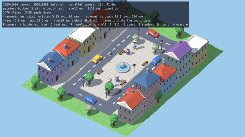
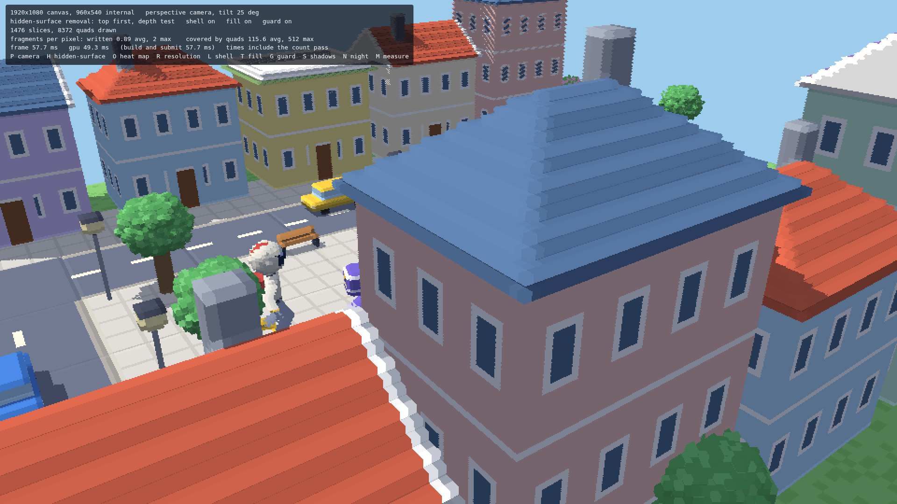

# Sprite stack engine



A small sprite-stacking renderer in plain WebGL2, with no libraries. Everything on screen is a stack of flat
slices, drawn as textured quads. The camera turns, tilts and zooms freely, in a parallel or a perspective
view, and the cost stays near one fragment written per pixel.

It exists to test two claims about sprite stacking with numbers instead of opinions:

- *"Slices break apart with a free camera."* They do if you draw one quad per slice. They do not if every
  slice is drawn once per screen row its layer covers. Press **T** to see both.
- *"Overdraw is around 99x at 1080p."* Drawn naively it is worse than that: this scene reaches **222 fragments
  per pixel** at street level. Drawn front to back with a depth test it is **1.07**. Press **O** for the heat
  map and **H** to switch.

Open `index.html` in a browser with WebGL2. It runs from the file system; there is nothing to install or build.

| | |
| --- | --- |
| Drag | turn and tilt |
| Shift-drag, right-drag | pan |
| Wheel | zoom |
| P | parallel / perspective camera |
| H | painter order / hidden-surface removal |
| O | overdraw heat map: fragments written, fragments covered, off |
| M | measure fragments per pixel every frame |
| R | internal resolution: full, half, third |
| L | shell stacks on / off |
| T | thickness fill on / off |
| G | edge-on guard on / off |
| S, N | shadows, night |

## Measured

1920x1080 canvas, headless Chromium, one desktop GPU (NVIDIA RTX 5090, ANGLE on Vulkan). "Overview" is the
parallel camera over the whole block; "street" is the perspective camera low among the houses, the worst case
here. Fragments are counted exactly by the count pass (see below), not estimated. Milliseconds are whole
frames: building and sorting the instances, the slice pass, the light pass and the blit, each frame waited
for, averaged over 200 frames.

| view | resolution | order | quads | written avg | written max | covered avg | covered max | ms/frame |
| --- | --- | --- | ---: | ---: | ---: | ---: | ---: | ---: |
| overview | native 1920x1080 | painter, whole stacks | 5458 | 15.42 | 192 | 16.0 | 192 | 0.64 |
| overview | native 1920x1080 | painter, shell stacks | 5458 | 5.85 | 89 | 16.0 | 192 | 0.57 |
| overview | native 1920x1080 | hidden-surface, whole stacks | 5458 | 0.44 | 2 | 16.0 | 192 | 0.44 |
| overview | native 1920x1080 | hidden-surface, shell stacks | 5458 | 0.44 | 2 | 16.0 | 192 | 0.46 |
| overview | internal 960x540 | painter, whole stacks | 2872 | 8.00 | 97 | 8.3 | 97 | 0.29 |
| overview | internal 960x540 | painter, shell stacks | 2872 | 3.18 | 47 | 8.3 | 97 | 0.36 |
| overview | internal 960x540 | hidden-surface, whole stacks | 2872 | 0.44 | 2 | 8.3 | 97 | 0.38 |
| overview | internal 960x540 | hidden-surface, shell stacks | 2872 | 0.44 | 2 | 8.3 | 97 | 0.25 |
| street | native 1920x1080 | painter, whole stacks | 15982 | 222.07 | 994 | 226.5 | 994 | 3.29 |
| street | native 1920x1080 | painter, shell stacks | 15982 | 81.34 | 453 | 226.5 | 994 | 2.00 |
| street | native 1920x1080 | hidden-surface, whole stacks | 15982 | 1.07 | 4 | 226.5 | 994 | 1.00 |
| street | native 1920x1080 | hidden-surface, shell stacks | 15982 | 1.07 | 4 | 226.5 | 994 | 0.83 |
| street | internal 960x540 | painter, whole stacks | 8372 | 113.35 | 512 | 115.6 | 512 | 0.82 |
| street | internal 960x540 | painter, shell stacks | 8372 | 41.82 | 236 | 115.6 | 512 | 0.59 |
| street | internal 960x540 | hidden-surface, whole stacks | 8372 | 0.89 | 2 | 115.6 | 512 | 0.48 |
| street | internal 960x540 | hidden-surface, shell stacks | 8372 | 0.89 | 2 | 115.6 | 512 | 0.48 |

- **written**: fragments that reached the G-buffer, per screen pixel (all pixels, sky included; the overview is
  about half sky, which is why its best case is 0.44 and not 1).
- **covered**: fragments the quads cover, with no alpha or depth test. This is the rasteriser's load.
- Internal 960x540 is measured per internal pixel; it has a quarter of the pixels to begin with.

What the numbers say, and what they do not:

- The naive figure is real. Painter order at street level writes 222 fragments per pixel on average and 994 at
  the worst pixel.
- Hidden-surface removal takes written fragments from 222 to 1.07 (a factor of 207). The scene looks the same.
- It does **not** reduce what the rasteriser covers: 226 fragments per pixel still reach the depth test. A
  rejected fragment is cheap but not free, and whether the GPU runs the fragment shader for it depends on its
  early depth test. That is why this table reports "written" and "covered" and never "shaded".
- Shell stacks cut written fragments 2.5 to 2.7 times in painter order and change nothing once the depth test
  is on.
- Half resolution halves the fragments per pixel as well as quartering the pixels, because each layer needs
  half as many copies.
- On this GPU every row is far under a 60 Hz frame (16.7 ms), so these timings mostly show that the scene is
  small for the hardware. The fragment counts are the hardware-independent part. Run `tools/bench.py` on your
  own machine; `--software` uses a CPU rasteriser, where fill cost is not hidden.

The two heat maps below are the street view at 1920x1080. (The frame times printed in these stills include the
count pass and its read-back, so they are not the timings in the table.)


## The techniques

**Slices as instanced quads** (`js/engine.js`, `build` and `VS_SLICE`). Each slice copy is one instance:
position, rotation, atlas rectangle, offset from the stack's axis, scale. The whole scene is one
`drawArraysInstanced` call per pass.

**Thickness fill.** A layer is a slab but a slice is a plane, so a tilted camera sees between them. Each slice
is drawn once for every screen row its layer is tall, `ceil(pixels per unit * cos(pitch))` copies at heights
`z + k / copies`. In perspective the count is worked out per stack from its distance.




**Edge-on guard.** Near the horizon a slice has almost no height on screen and can fall between two pixel rows.
The vertex shader pushes every corner half a pixel away from the slice's centre line, so a slice always covers
at least one row.

**Height order is depth order.** With the camera above the scene, the higher of two points on one view ray is
always the nearer one. Sorting by height is therefore an exact depth sort for the parallel and for the
perspective camera, as long as every ray points downward (`pitch > fov / 2`; the demo clamps the tilt). The sort
is a counting sort into height buckets, redone every frame.

**Painter order.** Lowest bucket first, no depth test. Every slice is drawn in full. This is the classic
method and the source of the overdraw.

**Hidden-surface removal.** The same instances, highest bucket first, with the depth test and depth writes on.
The first slice to reach a pixel is the visible one and everything under it is rejected. It is the idea behind
drawing opaque geometry front to back on any z-buffered hardware.

**Shell stacks** (`js/art.js`). A slice pixel deep inside a solid is always hidden by the layer above. When the
atlas is built, pixels more than three from empty space are left out, so their fragments are discarded instead
of written. Slices are also cropped to their filled rectangle and empty layers dropped.

**Deferred lighting.** The slice pass writes no colour. It writes a small G-buffer: palette index, the facing
of that surface pixel (a normal worked out per slice pixel when the stack is built, turned with the slice),
and height. The light pass then runs once per screen pixel: it looks up the colour, rebuilds the world position
by intersecting the pixel's view ray with the plane at the stored height, and computes sun, shadow and lamps.
Lighting cost does not grow with overdraw.

**Shadows.** A height map of the static scene holds the tallest solid over each ground cell. The light pass
marches from the pixel towards the sun and tests against it. The walking figures are not in the map; each is
treated as a cylinder.

**Internal resolution.** The slice and light passes can run at a half or a third of the canvas size and are
scaled up without smoothing, for a pixel-art look or for slower hardware.

**The count pass.** The same instances are drawn again into a 16-bit float target with additive blending,
adding 1 per fragment: once with the same tests as the real pass (written) and once with none (covered). The
texture is read back for the average and maximum, and shown through a colour ramp as the heat map.

## Where a mesh is still the better tool

- **Views from below or along the horizon.** Height order is only depth order while every ray points downward,
  and the perspective camera here is clamped for that reason. A first-person view needs a different renderer.
- **Smooth or sloped surfaces close up.** A stack is stair-stepped at one layer per step. Roofs here show it.
- **Rasteriser load.** Hidden-surface removal fixes fragments written, not fragments covered. A mesh draws
  only surfaces; a stack draws every layer's rectangle. Where raster throughput is the limit (very high
  resolution, weak or tile-based GPUs), a mesh of the same building is far cheaper.
- **Exact shadows and overhangs.** The height-map shadow cannot represent anything with air under it.
- **Memory for large solids.** A stack stores every layer; a box needs twelve triangles.

Stacks earn their place where the art is authored as pixel layers, objects are small or medium, the camera
stays above the scene, and the look of layered pixels is the point.

## The demo scene

A town block, 320 by 256 art pixels: ten houses round a paved square with a fountain, a ring road, trees,
lamps, benches, cars, and four walking figures. All of it is described as small functions in `js/town.js` and
built into slices when the page loads. The figures and their walk come from
[sprite-stack-animation](https://github.com/loktar00/sprite-stack-animation) (`js/rig.js`, `js/characters.js`).

1476 slices; about 2,900 to 16,000 quads a frame depending on camera and resolution.

## Files

| Path | What |
| --- | --- |
| `index.html` | the demo page |
| `js/engine.js` | the renderer: instances, slice pass, count pass, light pass |
| `js/art.js` | stacks from functions: voxels, normals, shell, atlas |
| `js/town.js` | the scene: palette, stacks, layout |
| `js/characters.js`, `js/rig.js` | the walking figures |
| `js/main.js` | camera, input, read-out, capture hooks |
| `tools/bench.py` | the table above |
| `tools/capture.py`, `tools/encode.sh` | frames, MP4 and GIF of the camera tour |
| `skills/sprite-stack-engine/SKILL.md` | the techniques written up as an agent skill |

## Reproducing the numbers

Needs Python with Playwright (`pip install playwright`, `playwright install chromium`).

```sh
python tools/bench.py                 # GPU
python tools/bench.py --software      # CPU rasteriser
sh tools/encode.sh                    # out/tour.mp4 and out/tour.gif (needs ffmpeg)
```

In the page, `demo.measure()` returns the counts for the current view and `demo.bench(n)` the milliseconds per
frame over `n` frames.

## Licence

MIT. See `LICENSE`.
